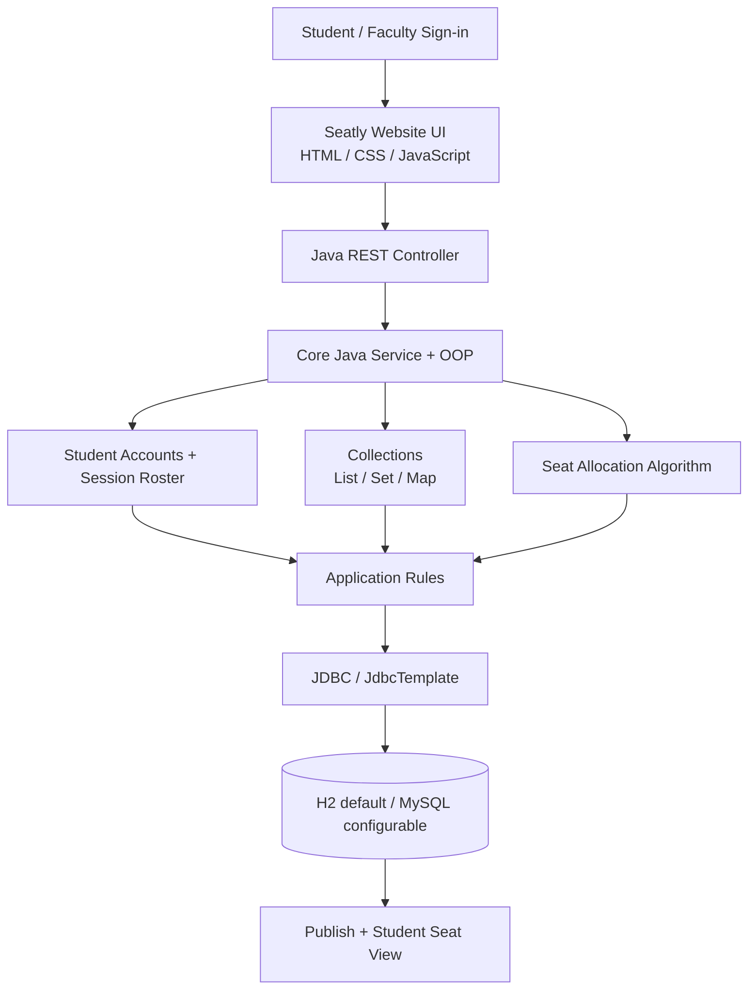

# Flowchart mapping

The source DOCX describes a Java mini-project architecture using JavaFX, Core Java, OOP, Collections, data structures and algorithms, JDBC, and a SQL database. Because the requested output is a website resembling the supplied Seatly HTML, this implementation uses a browser frontend and a Java REST backend. `SeatlyService` handles accounts, rosters, rooms and sessions; `SeatAllocationEngine` creates row-major seat assignments; JDBC stores persistent state. Passwords are hashed in the Java version.

The source diagram includes an AI node but does not specify a model or AI task. This project does not claim to implement an AI model; seating allocation is deterministic and rule-based.
